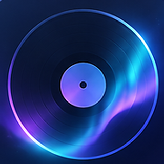
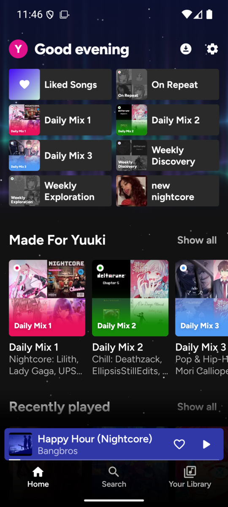
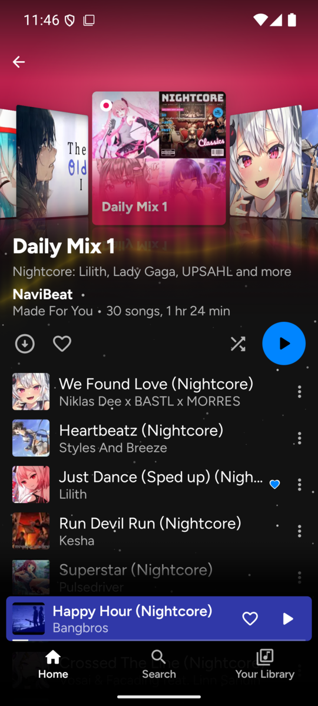
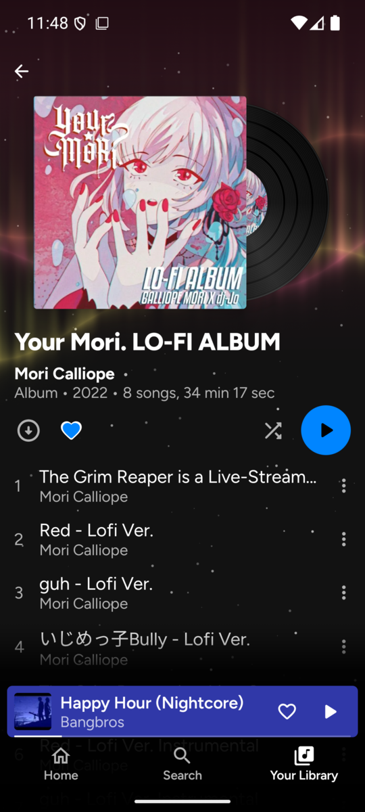
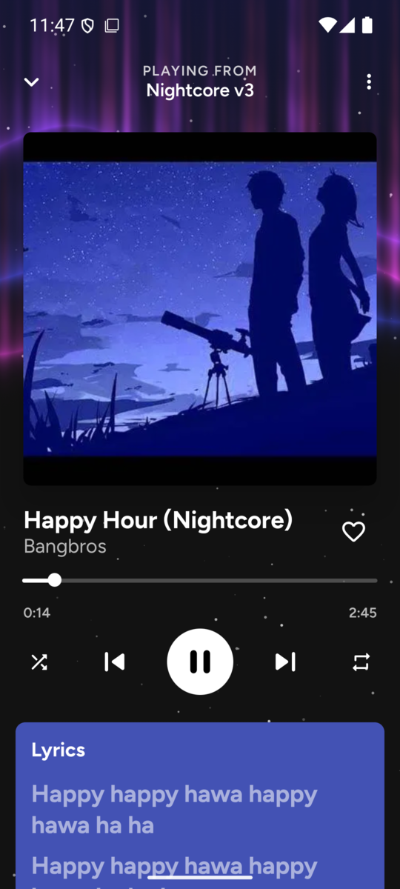
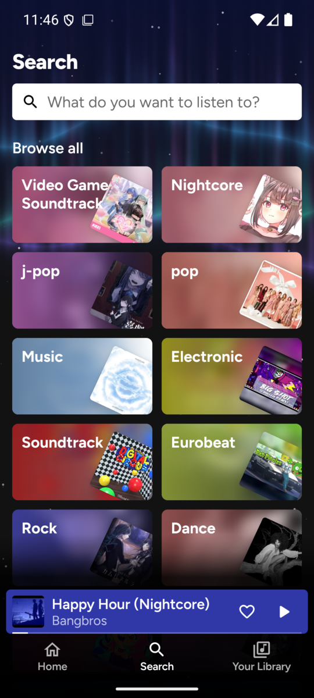
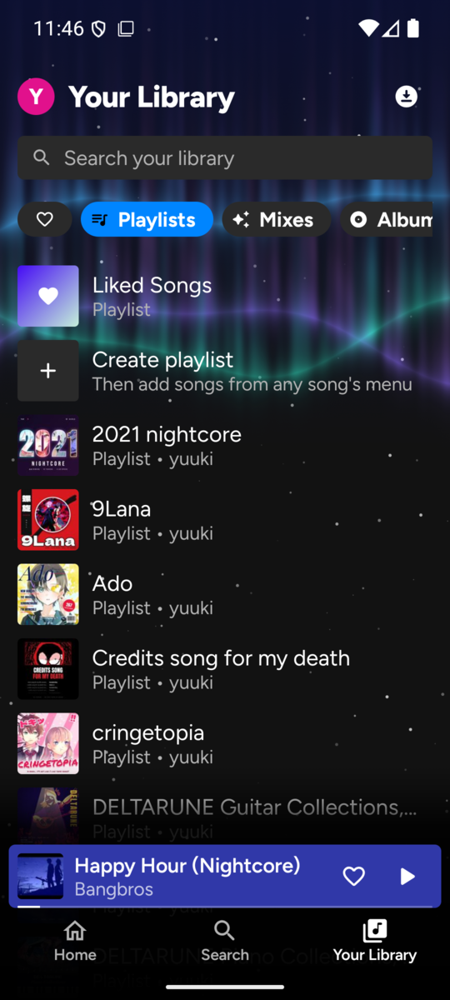
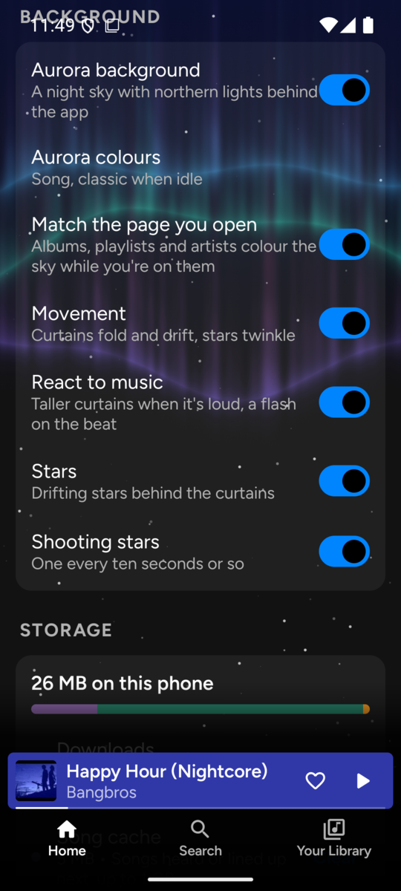
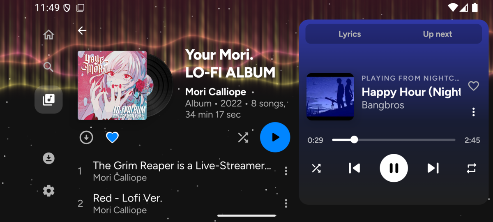

<div align="center">



# navidroid

**An Android client for Navidrome, styled after its Spotify-like web UI.**

Point it at your [Navidrome](https://www.navidrome.org/) server and get your library, mixes and
playlists in your pocket, online or off. There's an aurora behind it that moves with the music, and
layouts for phones and tablets in either orientation.

[](https://kotlinlang.org)
[](https://developer.android.com/compose)
[](https://developer.android.com/media/media3)
[](https://www.android.com)
[](https://www.navidrome.org)

</div>

---

## Screenshots

<table>
<tr>
<td width="25%">

**Home**: Liked Songs, your mixes and recently played


</td>
<td width="25%">

**Mix**: a cover flow of its albums, in the mix's own colour


</td>
<td width="25%">

**Album**: the record slides out of its sleeve and turns while it plays


</td>
<td width="25%">

**Player**: synced lyrics under the controls


</td>
</tr>
<tr>
<td width="25%">

**Search**: genre cards drawn from your cover art


</td>
<td width="25%">

**Your Library**: playlists, mixes, albums and artists, searchable


</td>
<td width="25%">

**Look**: tune the aurora, its colours and how it reacts to music


</td>
<td width="25%">
</td>
</tr>
<tr>
<td colspan="4">

**Landscape**: an icon rail, the page, and a docked player with lyrics and the queue


</td>
</tr>
</table>

## Features

- 🏠 **Home & Library**: home, playlists, albums, artists, search and library, with the NaviBeat and Explo mixes sorted into the same sections as the web UI ("Made For you", "Your top mixes", ...)
- 🌌 **Aurora**: an animated night sky behind the app, with drifting and shooting stars. It takes its colours from the song or the page you're on, and its curtains rise and flash with the music, timed to what the speaker is playing
- 🎞 **Animated Headers**: albums slide their record out of the sleeve, playlists show a drifting wall of covers, mixes show a swipeable cover flow, artists get a photo ring over their releases, and genres fan their covers out like a hand of cards
- 📱 **Phones & Tablets**: a docked player in landscape, a labelled rail on tablets, a library column beside the page on landscape tablets and a player bar on portrait ones
- 🌐 **Multiple Servers**: several server addresses (LAN and public) are pinged in parallel and the fastest one is used, with failover when one goes down or the network changes
- ⬇️ **Offline Downloads**: download playlists, albums or Liked Songs as Opus at the bitrate you pick. Pinned collections re-sync on launch, so rotating mixes pick up new songs and drop removed ones
- 💾 **Instant Screens**: server answers are saved on disk, so screens open straight away and still work offline. Songs you're about to play are cached ahead of time so they start instantly
- 📡 **Offline Scrobbling**: plays of downloaded songs are still reported to Navidrome. Scrobbles made offline are queued and sent with their original time
- ✅ **Multi-select**: press and hold songs, playlists, albums or artists to play, queue, like, download, hide or add several to a playlist at once
- ♾️ **Autoplay**: when the queue runs out, it keeps going with similar songs, or with downloaded ones when you're offline
- 🎤 **Synced Lyrics**: follow along line by line in the player
- 👤 **Artist Pages**: albums, singles and EPs, and appearances in their own sections; songs with several artists let you pick which one to open
- 🎨 **Theme & Icon**: seven theme colours or your own, four aurora launcher icons plus the classic discs, and aurora palettes you can mix yourself
- 👆 **Gestures & Buttons**: swipe the artwork or mini player to skip, swipe down to close the player; headset buttons play/pause, skip and go back
- ⏯ **Persistent Queue**: picks up where you left off
- 📶 **Quality Settings**: separate streaming quality for Wi-Fi and mobile data, and a monthly data usage readout

## Tech Stack

| Layer | Choice |
|---|---|
| Language | Kotlin 2.4 |
| UI | Jetpack Compose, Material 3, Navigation 3, AGSL shaders (aurora) |
| Playback | Media3 (ExoPlayer + MediaSession), OkHttp data source |
| Images | Coil 3, Palette |
| Server API | Navidrome (Subsonic / OpenSubsonic) |
| Build | Gradle (AGP 9), JDK 17+ |

## Quick Start

Grab the APK from [Releases](https://github.com/rene-roid/navidroid/releases) and sign in with your
Navidrome address, username and password. You can add more addresses (say, a LAN one) in Settings
afterwards. Runs on Android 9 (API 28) and newer.

> v1.0.0 and v1.1.0 install as `com.netease.cloudmusic`. Releases after that are
> `xyz.yuuki.navidroid` and won't update the old build in place, so install them fresh.

## Development

Needs **JDK 17+** and the Android SDK (compileSdk 37).

```sh
./gradlew assembleGithubRelease      # app/build/outputs/apk/github/release/app-github-release.apk
./gradlew installGithubDebug         # build and install on a connected device
./gradlew testGithubDebugUnitTest    # unit tests (mixes, lyrics, release types, search ranking, levels)
```

There are two product flavors. `github` is the one to ship, as `xyz.yuuki.navidroid`. `xiaomi` installs
as `com.netease.cloudmusic`, a music app's package, because the Xiaomi 17 Pro's rear screen only plays
along with a fixed list of those.

## Project Structure

```
navidroid/
├── app/src/
│   ├── main/java/xyz/yuuki/navidroid/
│   │   ├── Api.kt              # Navidrome/Subsonic client, models, prefs, server racing, disk cache
│   │   ├── App.kt              # Application setup, network change handling
│   │   ├── MainActivity.kt     # Entry point
│   │   ├── Mixes.kt            # NaviBeat / Explo mix grouping
│   │   ├── Offline.kt          # Downloads and pinned collection sync
│   │   ├── PlaybackService.kt  # Media3 playback service, scrobbling, autoplay
│   │   ├── Levels.kt           # Loudness and beat detection for the aurora
│   │   └── ui/                 # Screens, headers, player, aurora, settings, theme
│   └── test/                   # JUnit tests
├── assets/                     # Icon
├── design/                     # Landscape and tablet mockups
└── docs/screenshots/
```
