<div align="center">

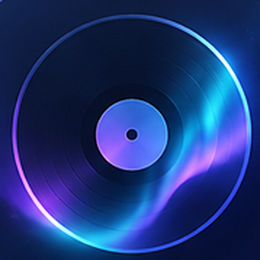

# navidroid

**An Android client for Navidrome, styled after its Spotify-like web UI.**

Point it at your [Navidrome](https://www.navidrome.org/) server and get your library, mixes and
playlists in your pocket, online or off. There's an aurora behind it that moves with the music, and
layouts for phones and tablets in either orientation. Start a song and it keeps the music going with a
radio, put widgets on your home screen, or share a link and let friends pick the songs with you.

[](https://kotlinlang.org)
[](https://developer.android.com/compose)
[](https://developer.android.com/media/media3)
[](https://www.android.com)
[](https://www.navidrome.org)

</div>

---

## Screenshots

<table>
<tr>
<td width="25%">

**Home: Liked Songs, your mixes, what others are listening to and recently played**
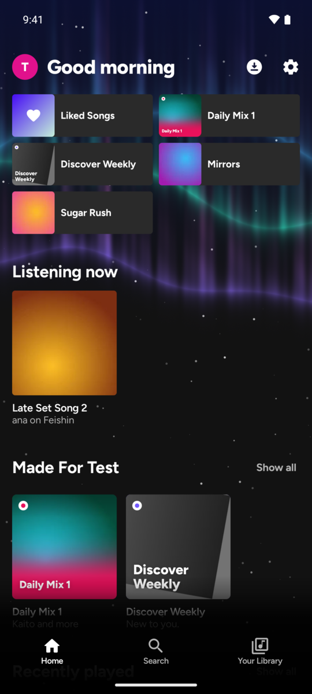

</td>
<td width="25%">

**Mix: a cover flow of its albums, in the mix's own colour**
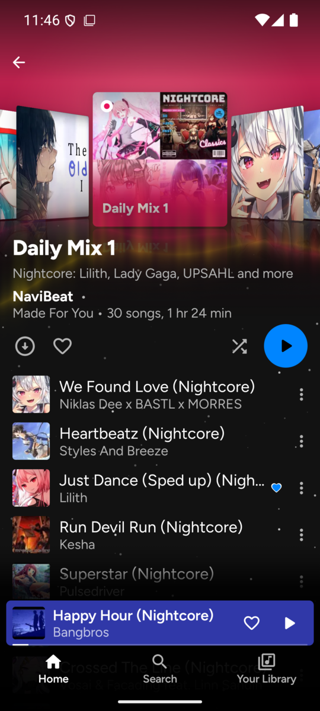

</td>
<td width="25%">

**Album: the record slides out of its sleeve and turns while it plays**
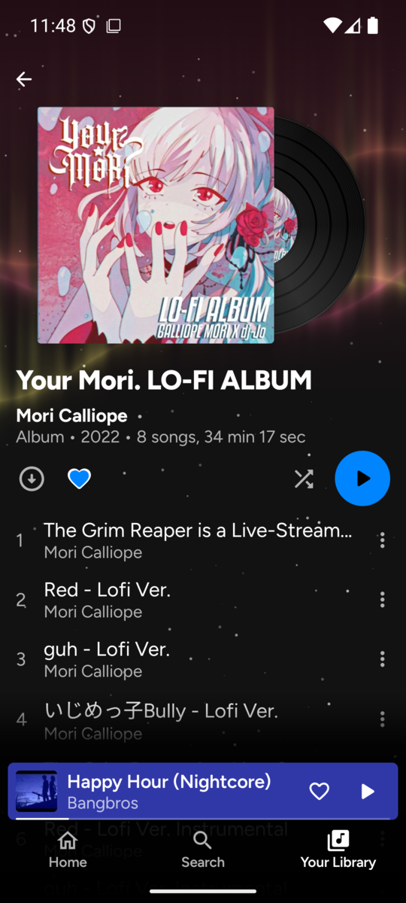

</td>
<td width="25%">

**Player: synced lyrics under the controls**
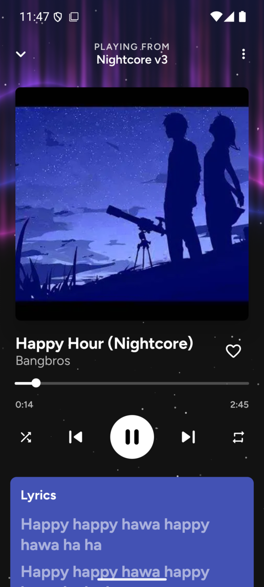

</td>
</tr>
<tr>
<td width="25%">

**Search: recent searches, albums you haven't played, decades and genre cards**
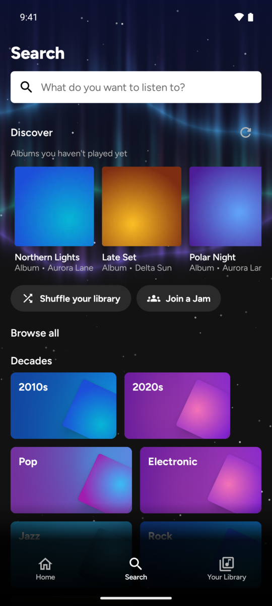

</td>
<td width="25%">

**Your Library: filters you can combine, with radios kept apart from your playlists**
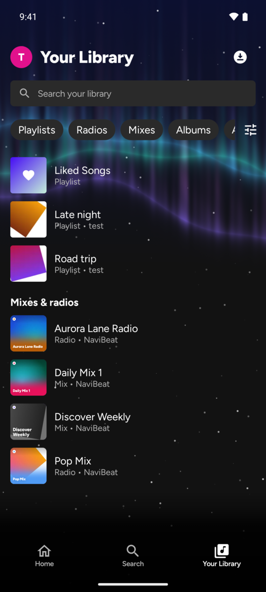

</td>
<td width="25%">

**Settings: your account and server, then a page for each topic**
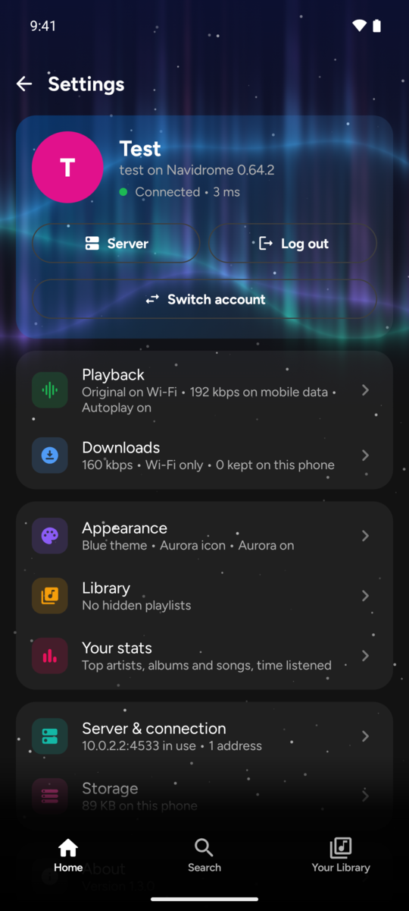

</td>
<td width="25%">

**Appearance: wallpaper colours, density, player style and the layout of Home**
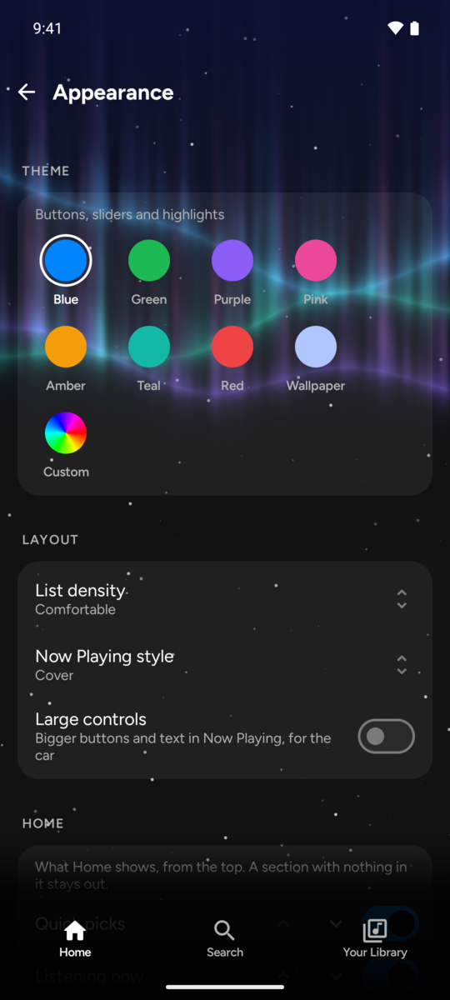

</td>
</tr>
<tr>
<td width="25%">

**Queue: song radio keeps going with similar songs; drag to reorder, or see what played**
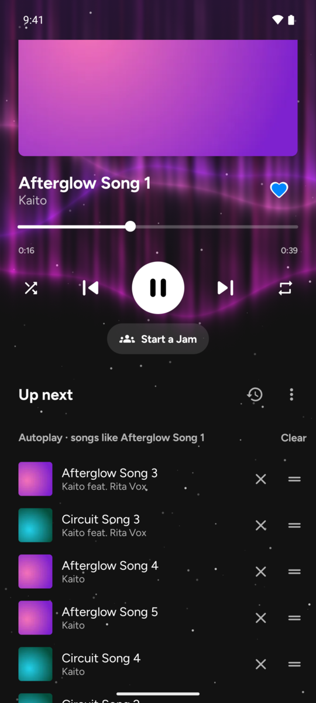

</td>
<td width="25%">

**Stats: your top artists, albums and songs, and the time you listened**
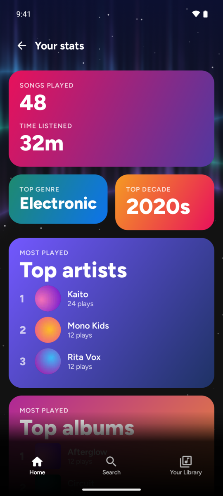

</td>
<td width="25%">

**Jam: share a link so friends can add songs, with the rules set by you**
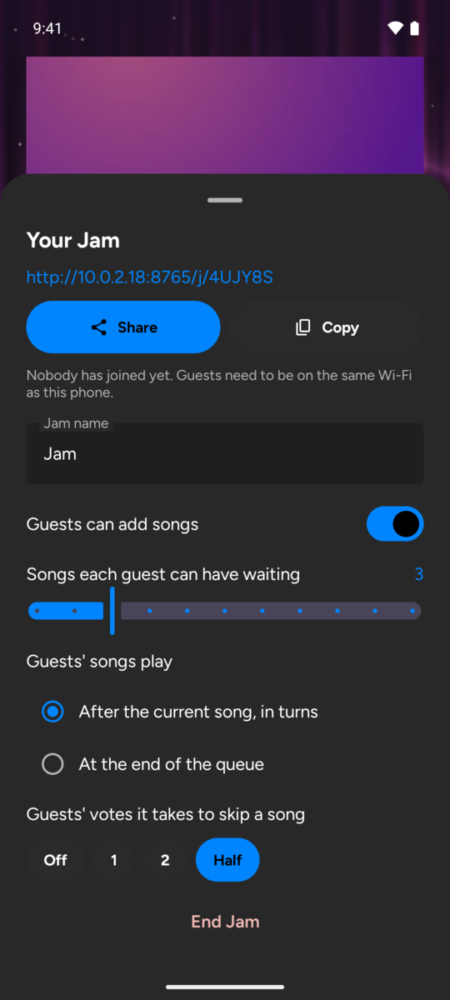

</td>
<td width="25%">

**Widgets: now playing and your playlists on the home screen**
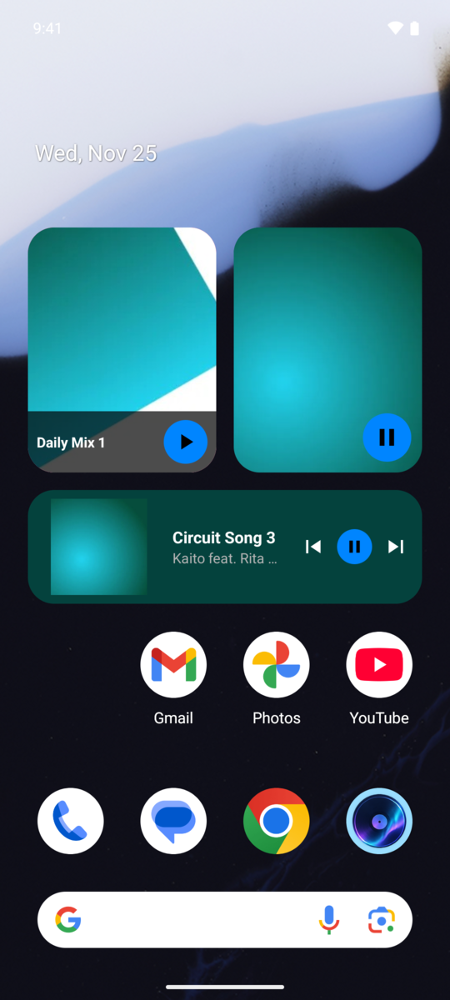

</td>
</tr>
<tr>
<td colspan="4">

**Landscape**: an icon rail, the page, and a docked player with lyrics and the queue
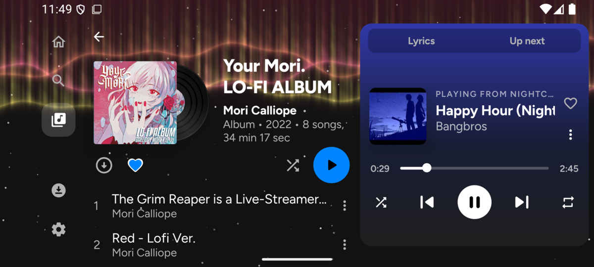

</td>
</tr>
</table>

## Features

- 🏠 **Home & Library**: home, playlists, albums, artists, search and library, with the NaviBeat and Explo mixes sorted into the same sections as the web UI ("Made For you", "Your top mixes", ...)
- 🗂 **Library Filters**: Spotify-style chips you can combine, with an X to clear them. Playlists, radios, mixes, albums and artists each have their own sub-filters, radios stay apart from your playlists, and you can sort, switch to a grid or hide mixes and radios
- 📻 **Song Radio & Autoplay**: tap a song and it starts at once, with similar songs queued behind it. When a queue runs out it keeps going the same way, or with downloaded songs when you're offline, and songs you haven't played come first
- 🔎 **Discovery**: shelves of albums you haven't played, ones like what you just heard, "released 20 years ago" and "jump back in"; "Fans also like" on artist pages; decades and genre radios; recent searches and a shuffle of your whole library
- 👥 **Jams**: start a Jam from the player and share the link. Friends open it in a browser, or in the app, to add songs and vote to skip. You choose whether they can add, how many songs each can have waiting, how many votes skip, and whether their songs play in turns or at the end. It works on your Wi-Fi and over Tailscale
- 🎧 **Listening Now**: see who else is playing from your server, and on which app
- 🧩 **Widgets & Shortcuts**: a resizable now-playing widget and a playlist widget, both customizable and working with the app closed; long-press the icon for Liked Songs, a shuffle of your library and Search
- 🗓 **Queue Controls**: drag songs to reorder them, see what already played, set a sleep timer that fades out, change the speed, and shuffle without the same artist twice in a row
- 🚗 **Android Auto & Notification**: browse Liked Songs, playlists, mixes and downloads from the car, and like the current song from the notification
- 🌌 **Aurora**: an animated night sky behind the app, with drifting and shooting stars. It takes its colours from the song or the page you're on, and its curtains rise and flash with the music, timed to what the speaker is playing
- 🎞 **Animated Headers**: albums slide their record out of the sleeve, playlists show a drifting wall of covers, mixes show a swipeable cover flow, artists get a photo ring over their releases, and genres fan their covers out like a hand of cards
- 📱 **Phones & Tablets**: a docked player in landscape, a labelled rail on tablets, a library column beside the page on landscape tablets and a player bar on portrait ones
- 👤 **Accounts & Servers**: sign in to several Navidrome servers and switch between them, each with its own downloads and library. Each server can have several addresses (LAN and public), pinged in parallel with the fastest one used and failover when one goes down; the address is checked as you type
- ⬇️ **Offline Downloads**: download playlists, albums or Liked Songs as Opus at the bitrate you pick. Pinned collections re-sync on launch, so rotating mixes pick up new songs and drop removed ones. Turn on automatic downloads to keep Liked Songs and your daily mixes on the phone
- 💾 **Instant Screens**: server answers are saved on disk, so screens open straight away and still work offline. Songs you're about to play are cached ahead of time so they start instantly. After Android closes the app you come back to the page you were on
- 📡 **Offline Scrobbling**: plays of downloaded songs are still reported to Navidrome. Scrobbles made offline are queued and sent with their original time
- ✅ **Playlists & Multi-select**: edit your own playlists in place (reorder, remove, rename, make public, delete), swipe a song to queue it, and press and hold songs, playlists, albums or artists to play, queue, like, download, hide or add several to a playlist at once
- 📊 **Your Stats & Sharing**: your top artists, albums, songs, genre and decade, and the time you listened. Share a song, album or playlist as a public link through the server
- 🎤 **Synced Lyrics**: follow along line by line in the player
- 👤 **Artist Pages**: albums, singles and EPs, and appearances in their own sections; songs with several artists let you pick which one to open
- 🎨 **Look & Feel**: seven theme colours, your own, or the colours of your wallpaper; aurora palettes you can mix yourself; compact lists; a Vinyl or lyrics-first player and large controls; choose what Home shows and in which order; four aurora launcher icons plus the classic discs
- 👆 **Gestures & Buttons**: swipe the artwork or mini player to skip, swipe down to close the player; headset buttons play/pause, skip and go back
- ⏯ **Persistent Queue**: picks up where you left off
- 📶 **Quality Settings**: separate streaming quality for Wi-Fi and mobile data, ReplayGain, and a monthly data usage readout

## Tech Stack

| Layer | Choice |
|---|---|
| Language | Kotlin 2.4 |
| UI | Jetpack Compose, Material 3, Navigation 3, AGSL shaders (aurora) |
| Playback | Media3 (ExoPlayer + MediaLibraryService), OkHttp data source |
| Widgets | Jetpack Glance |
| Images | Coil 3, Palette |
| Server API | Navidrome (Subsonic / OpenSubsonic) |
| Build | Gradle (AGP 9), JDK 17+ |

## Quick Start

Grab the APK from [Releases](https://github.com/rene-roid/navidroid/releases) and sign in with your
Navidrome address, username and password. You can add more addresses (say, a LAN one) and more
accounts in Settings afterwards. Runs on Android 9 (API 28) and newer. Releases from 1.2.0 on update
in place.

> v1.0.0 and v1.1.0 install as `com.netease.cloudmusic`. Releases after that are
> `xyz.yuuki.navidroid` and won't update the old build in place, so install them fresh.

## Development

Needs **JDK 17+** and the Android SDK (compileSdk 37).

```sh
./gradlew assembleGithubRelease      # app/build/outputs/apk/github/release/app-github-release.apk
./gradlew installGithubDebug         # build and install on a connected device
./gradlew testGithubDebugUnitTest    # unit tests (library filters, mixes, jams, accounts, radio, search ranking, ...)
scripts/check-release-ctors.sh app/build/outputs/apk/github/release/app-github-release.apk
```

Run the release build on a device before shipping it, not just the debug one. R8 can strip classes that
Room and WorkManager create by reflection, which crashes the release build at launch; the keep rules are in
`app/keep-rules.pro` and the script above checks an APK for it.

There are two product flavors. `github` is the one to ship, as `xyz.yuuki.navidroid`. `xiaomi` installs
as `com.netease.cloudmusic`, a music app's package, because the Xiaomi 17 Pro's rear screen only plays
along with a fixed list of those.

## Project Structure

```
navidroid/
├── app/src/
│   ├── main/java/xyz/yuuki/navidroid/
│   │   ├── Api.kt              # Navidrome/Subsonic client, models, prefs, server racing, disk cache
│   │   ├── App.kt              # Application setup, network change handling, per-account paths
│   │   ├── Accounts.kt         # Account registry and path naming
│   │   ├── MainActivity.kt     # Entry point
│   │   ├── Library.kt          # Library filters, facets and sorting
│   │   ├── Mixes.kt            # NaviBeat / Explo mix grouping, Home shelves
│   │   ├── Offline.kt          # Downloads, pinned collection sync, automatic pins
│   │   ├── PlaybackService.kt  # Media3 library service, scrobbling, autoplay, sleep timer
│   │   ├── Browse.kt           # Browse tree for Android Auto and other media browsers
│   │   ├── Jam.kt              # Jams: the host's local server, rules and guests
│   │   ├── Widget.kt           # Now playing widget (Glance)
│   │   ├── PlaylistWidget.kt   # Playlist widget and its configuration
│   │   ├── Shortcuts.kt        # Launcher shortcuts
│   │   ├── Stats.kt            # Your stats
│   │   ├── Levels.kt           # Loudness and beat detection for the aurora
│   │   └── ui/                 # Screens, headers, player, aurora, settings, theme
│   └── test/                   # JUnit tests
├── design/                     # Landscape and tablet mockups
├── scripts/                    # check-release-ctors.sh
└── docs/                       # ROADMAP.md and screenshots
```
